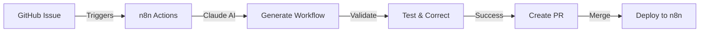

# n8n Actions Documentation

Welcome to the n8n Actions documentation hub. This system enables AI-powered workflow generation for n8n using natural language descriptions.

## 📚 Documentation Structure

### 🚀 [Quick Start](quickstart/)
Get started with n8n Actions in minutes
- [Quick Start Guide](quickstart/quickstart.md) | [日本語版](quickstart/quickstart-jp.md)
- [Setup Guide](quickstart/setup-guide.md) | [日本語版](quickstart/setup-guide-jp.md)

### 🔧 [n8n Workflows](n8n-workflows/)
Core workflow documentation and specifications
- [n8n Actions Overview](n8n-workflows/n8n-actions.md) | [日本語版](n8n-workflows/n8n-actions-jp.md)
- [Workflow Specification](n8n-workflows/workflow-specification.md) | [日本語版](n8n-workflows/workflow-specification-jp.md)
- [GitHub Integration](n8n-workflows/github-integration.md) | [日本語版](n8n-workflows/github-integration-jp.md)
- [Webhook Configuration](n8n-workflows/webhook-configuration.md) | [日本語版](n8n-workflows/webhook-configuration-jp.md)
- [Workflow ID Management](n8n-workflows/workflow-id-management.md) | [日本語版](n8n-workflows/workflow-id-management-jp.md)

### 📖 [References](references/)
Examples, FAQs, and additional resources
- [Examples](references/examples.md) | [日本語版](references/examples-jp.md)
- [FAQ](references/faq.md) | [日本語版](references/faq-jp.md)

## 🎯 What is n8n Actions?

n8n Actions is an AI-powered workflow compiler that:
- 🤖 Generates n8n workflows from natural language
- 🔄 Self-corrects errors automatically
- 🚀 Integrates seamlessly with GitHub
- 📦 Deploys directly to your n8n instance

## 🌟 Key Features

### Natural Language to Workflow
Simply describe what you want in plain language, and n8n Actions generates a complete, production-ready n8n workflow.

### Self-Correction
If the generated workflow has errors, the system automatically attempts to fix them (up to 3 attempts).

### GitHub Integration
Works through GitHub Issues and Pull Requests - no additional tools needed.

### Full Automation
From issue creation to workflow deployment, everything is automated.

## 🏗️ Architecture



## 🚦 Getting Started

### For New Users
1. Start with the [Quick Start Guide](quickstart/quickstart.md)
2. Follow the [Setup Guide](quickstart/setup-guide.md) for complete configuration
3. Check [Examples](references/examples.md) for inspiration

### For Developers
1. Review [Workflow Specification](n8n-workflows/workflow-specification.md)
2. Understand [GitHub Integration](n8n-workflows/github-integration.md)
3. Configure [Webhooks](n8n-workflows/webhook-configuration.md)

## 📝 Example Workflow Request

```markdown
### Workflow Name
customer-support-bot

### Description
AI-powered customer support that:
- Receives messages via webhook
- Analyzes sentiment with AI
- Routes to appropriate team
- Sends automated responses

### Trigger
Webhook

### Integrations
- OpenAI (sentiment analysis)
- Slack (team notifications)
- PostgreSQL (ticket storage)
```

## 🛠️ Supported Integrations

n8n Actions supports all n8n nodes including:

### Core Nodes
- Webhooks & Triggers
- Data Processing
- Flow Control
- Error Handling

### AI & Machine Learning
- OpenAI / Claude
- Google AI
- Custom AI Models

### Communication
- Slack, Discord, Telegram
- Email (SMTP, SendGrid)
- SMS (Twilio)

### Databases
- PostgreSQL, MySQL
- MongoDB, Redis
- Google Sheets

### Cloud Services
- AWS, Google Cloud, Azure
- Dropbox, Google Drive
- GitHub, GitLab

## 🤝 Contributing

We welcome contributions! Please see our [Contributing Guide](../CONTRIBUTING.md).

## 📄 License

MIT License - see [LICENSE](../LICENSE) file.

## 🆘 Support

- 📖 Check the [FAQ](references/faq.md)
- 💬 Open a [GitHub Issue](https://github.com/your-org/n8n-actions/issues)
- 🌐 Visit [n8n Community](https://community.n8n.io)

## 🔗 Links

- [n8n Documentation](https://docs.n8n.io)
- [Claude API Documentation](https://docs.anthropic.com)
- [GitHub Actions Documentation](https://docs.github.com/actions)

---

*Powered by Claude AI and the n8n community*