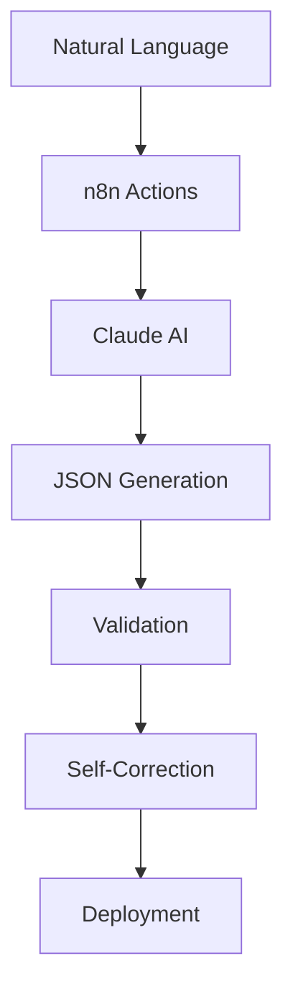

# n8n Workflows Documentation

Core documentation for n8n workflow specifications, integrations, and management.

## 📚 Documentation

### Core Documentation
- **[n8n Actions Overview](n8n-actions.md)** | [日本語版](n8n-actions-jp.md)
  - Complete guide to the AI-powered workflow compiler
  - Setup, usage, and best practices

- **[Workflow Specification](workflow-specification.md)** | [日本語版](workflow-specification-jp.md)
  - JSON structure and requirements
  - Node specifications and validation rules
  - Common patterns and examples

### Integration Guides
- **[GitHub Integration](github-integration.md)** | [日本語版](github-integration-jp.md)
  - GitHub Actions setup
  - Issue and PR workflows
  - Automated deployment pipelines

- **[Webhook Configuration](webhook-configuration.md)** | [日本語版](webhook-configuration-jp.md)
  - n8n webhook setup
  - GitHub webhook integration
  - Security and best practices

### Management
- **[Workflow ID Management](workflow-id-management.md)** | [日本語版](workflow-id-management-jp.md)
  - Finding and tracking workflow IDs
  - Editing existing workflows
  - Version control strategies

## 🎯 Quick Navigation

### By Task
| I want to... | Go to... |
|-------------|----------|
| Generate my first workflow | [n8n Actions Overview](n8n-actions.md) |
| Understand workflow JSON structure | [Workflow Specification](workflow-specification.md) |
| Set up GitHub automation | [GitHub Integration](github-integration.md) |
| Configure webhooks | [Webhook Configuration](webhook-configuration.md) |
| Edit existing workflows | [Workflow ID Management](workflow-id-management.md) |

### By Role
| Role | Start with... |
|------|---------------|
| Developer | [Workflow Specification](workflow-specification.md) |
| DevOps | [GitHub Integration](github-integration.md) |
| Administrator | [Webhook Configuration](webhook-configuration.md) |
| User | [n8n Actions Overview](n8n-actions.md) |

## 🔧 Core Concepts

### Workflow Generation Flow


### Key Components

#### 1. n8n Actions Compiler
- Powered by Claude AI
- Natural language processing
- Self-correcting generation

#### 2. Workflow Specification
- Standard JSON structure
- Node definitions
- Connection patterns

#### 3. GitHub Integration
- Automated workflows
- Issue-driven development
- PR-based deployment

#### 4. Webhook System
- Event triggers
- Real-time processing
- Security measures

## 📋 Common Workflows

### Basic Patterns
- **Webhook → Process → Response**
- **Schedule → Fetch → Transform → Store**
- **Trigger → Condition → Action**

### Advanced Patterns
- **Multi-branch Processing**
- **Error Recovery Loops**
- **Parallel Execution**
- **AI-Enhanced Workflows**

## 🚀 Best Practices

### Workflow Design
1. Start simple, add complexity gradually
2. Always include error handling
3. Use descriptive node names
4. Document complex logic

### Security
1. Never hardcode credentials
2. Use n8n credential system
3. Implement webhook authentication
4. Validate all inputs

### Performance
1. Minimize API calls
2. Use batch processing
3. Implement caching
4. Monitor execution times

## 🛠️ Tools & Scripts

### Validation
```bash
# Validate workflow JSON
node scripts/validate-workflow.js workflow.json
```

### ID Management
```bash
# Find workflow ID
node scripts/workflow-id-helper.js find "workflow-name"
```

### Testing
```bash
# Test webhook
curl -X POST https://your-n8n.com/webhook/test \
  -H "Content-Type: application/json" \
  -d '{"test": "data"}'
```

## 📊 Workflow Specifications Summary

### Required Fields
- `name`: Workflow identifier
- `nodes`: Array of node configurations
- `connections`: Node relationships
- `settings`: Execution settings

### Critical Settings
```json
{
  "settings": {
    "saveDataSuccessExecution": "all",  // Must be string!
    "saveDataErrorExecution": "all"     // Must be string!
  }
}
```

## 🔗 Related Resources

### Internal Documentation
- [Quick Start Guide](../quickstart/quickstart.md)
- [Setup Guide](../quickstart/setup-guide.md)
- [Examples](../references/examples.md)
- [FAQ](../references/faq.md)

### External Resources
- [n8n Documentation](https://docs.n8n.io)
- [n8n Node Reference](https://docs.n8n.io/nodes/)
- [Claude API Docs](https://docs.anthropic.com)

## 🆘 Getting Help

1. Check the relevant documentation above
2. Review [FAQ](../references/faq.md)
3. Search existing [GitHub Issues](https://github.com/your-org/n8n-actions/issues)
4. Open a new issue if needed

---

*Part of the n8n Actions automation system*