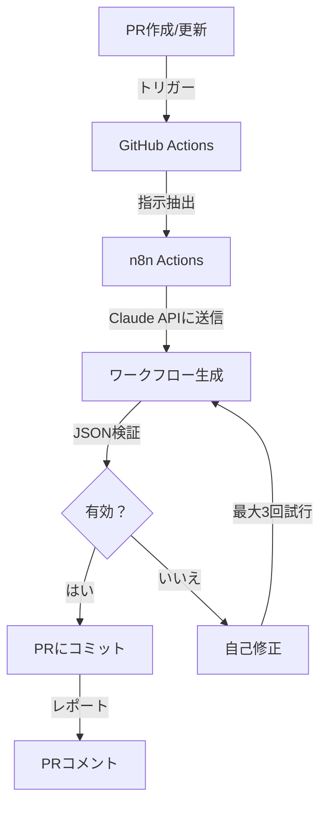

# n8n Actions - AIパワード・ワークフローコンパイラ

## 概要

n8n Actionsは、自然言語の指示からn8nワークフローを自動生成し、エラーがあれば自己修正する革新的なCI/CDパイプラインです。GitHub ActionsとClaude APIを組み合わせ、「プロンプトコード」という新しいパラダイムを実現します。

## ✨ 主な機能

- **自然言語からワークフロー生成**: PR本文に記述した指示から自動的にn8nワークフローを生成
- **自己修正メカニズム**: 生成されたワークフローにエラーがあれば自動的に修正（最大3回試行）
- **完全自動化**: PRを作成するだけで、検証済みのワークフローが自動コミット
- **詳細なフィードバック**: PR上に生成結果を分かりやすくレポート

## 🚀 セットアップ

### 1. 必要な準備

#### Anthropic API キーの取得
1. [Anthropic Console](https://console.anthropic.com/)にアクセス
2. API Keysセクションで新しいキーを生成
3. キーを安全に保管

#### GitHubシークレットの設定
1. リポジトリの`Settings` → `Secrets and variables` → `Actions`に移動
2. `New repository secret`をクリック
3. 以下のシークレットを追加:
   - **Name**: `ANTHROPIC_API_KEY`
   - **Value**: 取得したAnthropicのAPIキー

### 2. ディレクトリ構造

```
your-repo/
├── .github/
│   ├── workflows/
│   │   └── n8n-ai-compiler.yml    # メインワークフロー
│   └── scripts/
│       ├── generate-workflow.js    # ワークフロー生成スクリプト
│       └── correct-workflow.js     # 自己修正スクリプト
├── workflows/                       # n8nワークフローを配置
│   └── *.workflow.json
├── n8n_specs/                      # ワークフロー仕様書（オプション）
│   └── *.md
└── scripts/
    └── validate-workflow.js        # 検証スクリプト
```

## 📝 使い方

### 方法1: 新規ワークフローの生成

1. **新しいブランチを作成**
   ```bash
   git checkout -b feat/new-workflow
   ```

2. **自然言語の指示でプルリクエストを作成**
   
   PR本文の形式：
   ```markdown
   ## Generate n8n Workflow
   
   以下のワークフローを作成してください：
   - Webhookでデータを受信
   - AI（OpenAI）で処理
   - 結果をGoogle Sheetsに保存
   - Slackに通知を送信
   ```

3. **n8n Actionsが自動的に:**
   - PR本文を解析
   - n8nワークフローJSONを生成
   - 構造を検証
   - エラーがあれば自動修正
   - PRにコミット

### 方法2: 既存ワークフローの修正

1. **ワークフローを`workflows/`ディレクトリに配置**
2. **修正指示でPRを作成**
   ```markdown
   ## Correct n8n Workflow
   
   ワークフローを修正: example.workflow.json
   - エラーハンドリングを追加
   - API呼び出し頻度を最適化
   ```

## 🔧 システムアーキテクチャ

### 生成フロー



### コアコンポーネント

#### 1. ワークフロー生成器（`generate-workflow.js`）
- 自然言語の指示をClaude APIに送信
- 完全なn8nワークフローJSONを生成
- リトライロジックを実装

#### 2. 自己修正器（`correct-workflow.js`）
- 検証エラーを分析
- エラー情報をClaudeに送信
- 修正されたワークフローを再生成

#### 3. 検証器（`validate-workflow.js`）
- JSON構造をチェック
- n8nノード設定を検証
- 接続の整合性を確保

## 📊 プロンプトエンジニアリング

### システムプロンプトテンプレート

```javascript
const SYSTEM_PROMPT = `
あなたはn8nワークフロー設計のエキスパートです。
要件に基づいて有効なn8nワークフローJSONを生成してください。
エラーハンドリングを含め、パフォーマンスを最適化してください。
マークダウンや説明なしで、有効なJSONのみを出力してください。
`;
```

### ユーザープロンプト構造

```javascript
const userPrompt = `
要件：
${requirements}

制約：
- n8n v1.0+互換ノードを使用
- エラーハンドリングを含める
- パフォーマンスを最適化

出力：有効なn8nワークフローJSONのみ
`;
```

## 🎯 ベストプラクティス

### 1. 明確な指示
- データフローを具体的に記述
- 既知のノードタイプを指定
- エラーハンドリング要件を含める

### 2. ワークフロー最適化
- API呼び出しを最小限に
- 可能な限りバッチ処理を使用
- 適切なエラーハンドリングを実装

### 3. セキュリティ
- 認証情報をハードコーディングしない
- n8n認証システムを使用
- 入力検証を実装

## 🐛 トラブルシューティング

### よくある問題

| 問題 | 原因 | 解決方法 |
|------|------|----------|
| ワークフローが生成されない | 無効なPR形式 | PR本文の形式を確認 |
| JSON検証失敗 | 不正なJSON | 自動修正の試行を確認 |
| APIタイムアウト | 大きなワークフロー | より小さなワークフローに分割 |
| 認証エラー | セットアップ不足 | n8n認証を設定 |

### デバッグモード

ワークフローでデバッグログを有効化：
```yaml
env:
  DEBUG: true
```

## 📈 パフォーマンス指標

- **生成速度**: 平均30秒未満
- **成功率**: 自動修正込みで95%
- **リトライ効率**: 初回リトライで80%成功
- **リソース使用**: 最小限のGitHub Actions分数

## 🤝 コントリビューション

1. リポジトリをフォーク
2. フィーチャーブランチを作成
3. 変更を実装
4. テストを追加
5. PRを提出

## 📄 ライセンス

MIT License - LICENSEファイルを参照

## 🔗 関連リソース

- [n8nドキュメント](https://docs.n8n.io)
- [Claude APIドキュメント](https://docs.anthropic.com)
- [GitHub Actionsガイド](https://docs.github.com/actions)

---

*Claude AIとn8nコミュニティによって提供*