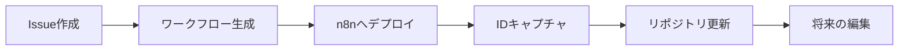

# n8nワークフローID管理ガイド

## 概要

このリポジトリでn8nワークフローを扱う際、編集、更新、適切なバージョン管理を可能にするためにワークフローIDを追跡する必要があります。このガイドでは、ワークフローIDの検索、管理、使用方法について説明します。

## ワークフローIDとは？

ワークフローIDは、n8nがワークフローの作成またはインポート時に割り当てる一意の英数字識別子（例：`abCDE1f6gHiJKL7`）です。このIDは以下の場所で確認できます：
- ワークフローURL：`https://your-n8n.com/workflow/abCDE1f6gHiJKL7`
- n8nのワークフロー設定
- GitHubのPRコメント（デプロイ後）

## ワークフローIDの検索方法

### 方法1：n8n UIから（最も簡単）

1. n8nインスタンスを開く
2. 編集したいワークフローに移動
3. ブラウザのURLを確認
4. IDは最後の部分：`https://n8n.com/workflow/[これがID]`

### 方法2：ヘルパースクリプトの使用

```bash
# すべてのワークフローとIDをリスト表示
node scripts/workflow-id-helper.js list

# 特定のワークフローを検索
node scripts/workflow-id-helper.js find "customer-onboarding"

# URLからIDを抽出
node scripts/workflow-id-helper.js extract https://n8n.com/workflow/abCDE1f6gHiJKL7
```

### 方法3：GitHub PRコメントから

n8n Actions経由でワークフローが生成されると、ボットがPRに以下をコメント：
- ワークフロー名
- n8nワークフローID
- デプロイステータス

## ワークフローIDの設定

ワークフローをn8nにデプロイした後、そのIDでリポジトリを更新：

```bash
# 実際のIDを使用してID設定
node scripts/workflow-id-helper.js set workflows/my-workflow.json abCDE1f6gHiJKL7

# n8n URLを使用してID設定（自動的にIDを抽出）
node scripts/workflow-id-helper.js set workflows/my-workflow.json https://n8n.com/workflow/abCDE1f6gHiJKL7
```

## ワークフローメタデータ構造

各ワークフローJSONファイルは`meta`フィールドにメタデータを含むことができます：

```json
{
  "name": "マイワークフロー",
  "nodes": [...],
  "connections": {...},
  "meta": {
    "n8nWorkflowId": "abCDE1f6gHiJKL7",
    "githubIssueId": "123",
    "githubPullRequest": "456",
    "deployedUrl": "https://n8n.com/workflow/abCDE1f6gHiJKL7",
    "lastUpdated": "2025-01-20T10:00:00Z",
    "description": "顧客オンボーディング自動化",
    "version": "1.2.0"
  }
}
```

## ワークフローライフサイクル



## IDマッピングファイル

リポジトリは`workflows/workflow-ids.json`にIDマッピングを維持：

```json
{
  "customer-onboarding.workflow.json": {
    "id": "abCDE1f6gHiJKL7",
    "name": "顧客オンボーディング",
    "url": "https://n8n.com/workflow/abCDE1f6gHiJKL7",
    "lastUpdated": "2025-01-20T10:00:00Z"
  },
  "data-sync.workflow.json": {
    "id": "xyZ789MnOpQ",
    "name": "データ同期",
    "url": "https://n8n.com/workflow/xyZ789MnOpQ",
    "lastUpdated": "2025-01-19T15:30:00Z"
  }
}
```

## 既存ワークフローの編集

### ステップ1：ワークフローIDを検索

上記のいずれかの方法でワークフローIDを取得。

### ステップ2：編集リクエストを作成

#### Issue経由
1. Issues → New Issueに移動
2. 「既存n8nワークフローの編集」テンプレートを選択
3. ワークフローIDと希望する変更を記入

#### PR説明経由
```markdown
## n8nワークフローの編集

**ワークフローID**: abCDE1f6gHiJKL7
**変更内容**:
- エラーハンドリングを追加
- APIエンドポイントを更新
- パフォーマンスを最適化
```

### ステップ3：AI生成をトリガー

n8n Actionsボットが以下を実行：
1. 既存のワークフローを取得
2. リクエストされた変更を適用
3. 更新されたワークフローを検証
4. PRに変更をコミット

## ベストプラクティス

### 1. 常にIDを追跡
- デプロイ直後にワークフローIDを記録
- マッピングファイルを最新に保つ
- コミットメッセージにIDを含める

### 2. バージョン管理
- メタデータでセマンティックバージョニングを使用
- 破壊的変更をドキュメント化
- 変更履歴を維持

### 3. IDセキュリティ
- 本番IDを公開しない
- 機密IDには環境変数を使用
- セキュリティのため定期的にIDをローテーション

## ヘルパースクリプトリファレンス

### インストール

```bash
npm install
```

### コマンド

| コマンド | 説明 | 例 |
|---------|------|-----|
| `list` | すべてのワークフローとIDをリスト | `node scripts/workflow-id-helper.js list` |
| `find <name>` | 名前でワークフローを検索 | `node scripts/workflow-id-helper.js find "onboarding"` |
| `set <file> <id>` | ワークフローIDを設定 | `node scripts/workflow-id-helper.js set workflow.json abc123` |
| `extract <url>` | URLからIDを抽出 | `node scripts/workflow-id-helper.js extract https://n8n.com/workflow/abc123` |
| `validate` | すべてのIDを検証 | `node scripts/workflow-id-helper.js validate` |

## トラブルシューティング

### よくある問題

| 問題 | 解決方法 |
|------|----------|
| IDが見つからない | ワークフローがn8nにデプロイされているか確認 |
| 重複ID | ワークフロー全体でユニークなIDか確認 |
| 無効なID形式 | 英数字形式を確保 |
| メタデータ不足 | metaフィールドでワークフローJSONを更新 |

### デバッグモード

詳細ログを有効化：

```bash
DEBUG=true node scripts/workflow-id-helper.js list
```

## APIリファレンス

### IDでワークフローを取得

```javascript
async function getWorkflow(id) {
  const response = await fetch(`${N8N_API_URL}/workflows/${id}`, {
    headers: {
      'X-N8N-API-KEY': process.env.N8N_API_KEY
    }
  });
  return response.json();
}
```

### ワークフローを更新

```javascript
async function updateWorkflow(id, workflowData) {
  const response = await fetch(`${N8N_API_URL}/workflows/${id}`, {
    method: 'PUT',
    headers: {
      'X-N8N-API-KEY': process.env.N8N_API_KEY,
      'Content-Type': 'application/json'
    },
    body: JSON.stringify(workflowData)
  });
  return response.json();
}
```

---

*n8n Actions自動化システムの一部*