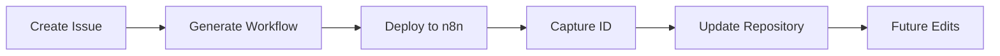

# n8n Workflow ID Management Guide

## Overview

When working with n8n workflows in this repository, you need to track workflow IDs to enable editing, updates, and proper version control. This guide explains how to find, manage, and use workflow IDs.

## What is a Workflow ID?

A workflow ID is a unique alphanumeric identifier (e.g., `abCDE1f6gHiJKL7`) that n8n assigns to each workflow when it's created or imported. This ID is visible in:
- The workflow URL: `https://your-n8n.com/workflow/abCDE1f6gHiJKL7`
- The workflow settings in n8n
- GitHub PR comments (after deployment)

## Finding Your Workflow ID

### Method 1: From n8n UI (Easiest)

1. Open your n8n instance
2. Navigate to the workflow you want to edit
3. Look at the URL in your browser
4. The ID is the last part: `https://n8n.com/workflow/[THIS-IS-THE-ID]`

### Method 2: Using the Helper Script

```bash
# List all workflows with their IDs
node scripts/workflow-id-helper.js list

# Find a specific workflow
node scripts/workflow-id-helper.js find "customer-onboarding"

# Extract ID from URL
node scripts/workflow-id-helper.js extract https://n8n.com/workflow/abCDE1f6gHiJKL7
```

### Method 3: From GitHub PR Comments

When a workflow is generated via n8n Actions, the bot comments on the PR with:
- Workflow name
- n8n workflow ID
- Deployment status

## Setting Workflow IDs

After deploying a workflow to n8n, update the repository with its ID:

```bash
# Set ID using the actual ID
node scripts/workflow-id-helper.js set workflows/my-workflow.json abCDE1f6gHiJKL7

# Set ID using the n8n URL (automatically extracts ID)
node scripts/workflow-id-helper.js set workflows/my-workflow.json https://n8n.com/workflow/abCDE1f6gHiJKL7
```

## Workflow Metadata Structure

Each workflow JSON file can contain metadata in the `meta` field:

```json
{
  "name": "My Workflow",
  "nodes": [...],
  "connections": {...},
  "meta": {
    "n8nWorkflowId": "abCDE1f6gHiJKL7",
    "githubIssueId": "123",
    "githubPullRequest": "456",
    "deployedUrl": "https://n8n.com/workflow/abCDE1f6gHiJKL7",
    "lastUpdated": "2025-01-20T10:00:00Z",
    "description": "Customer onboarding automation",
    "version": "1.2.0"
  }
}
```

## Workflow Lifecycle



## ID Mapping File

The repository maintains an ID mapping in `workflows/workflow-ids.json`:

```json
{
  "customer-onboarding.workflow.json": {
    "id": "abCDE1f6gHiJKL7",
    "name": "Customer Onboarding",
    "url": "https://n8n.com/workflow/abCDE1f6gHiJKL7",
    "lastUpdated": "2025-01-20T10:00:00Z"
  },
  "data-sync.workflow.json": {
    "id": "xyZ789MnOpQ",
    "name": "Data Synchronization",
    "url": "https://n8n.com/workflow/xyZ789MnOpQ",
    "lastUpdated": "2025-01-19T15:30:00Z"
  }
}
```

## Editing Existing Workflows

### Step 1: Find the Workflow ID

Use any of the methods above to get your workflow ID.

### Step 2: Create an Edit Request

#### Via Issue
1. Go to Issues → New Issue
2. Select "Edit Existing n8n Workflow" template
3. Fill in workflow ID and desired changes

#### Via PR Description
```markdown
## Edit n8n Workflow

**Workflow ID**: abCDE1f6gHiJKL7
**Changes**:
- Add error handling
- Update API endpoint
- Optimize performance
```

### Step 3: Trigger AI Generation

The n8n Actions bot will:
1. Fetch the existing workflow
2. Apply requested changes
3. Validate the updated workflow
4. Commit changes to PR

## Best Practices

### 1. Always Track IDs
- Record workflow IDs immediately after deployment
- Keep the mapping file updated
- Include IDs in commit messages

### 2. Version Control
- Use semantic versioning in metadata
- Document breaking changes
- Maintain change history

### 3. ID Security
- Never expose production IDs publicly
- Use environment variables for sensitive IDs
- Rotate IDs periodically for security

## Helper Script Reference

### Installation

```bash
npm install
```

### Commands

| Command | Description | Example |
|---------|-------------|---------|
| `list` | List all workflows with IDs | `node scripts/workflow-id-helper.js list` |
| `find <name>` | Find workflow by name | `node scripts/workflow-id-helper.js find "onboarding"` |
| `set <file> <id>` | Set workflow ID | `node scripts/workflow-id-helper.js set workflow.json abc123` |
| `extract <url>` | Extract ID from URL | `node scripts/workflow-id-helper.js extract https://n8n.com/workflow/abc123` |
| `validate` | Validate all IDs | `node scripts/workflow-id-helper.js validate` |

## Troubleshooting

### Common Issues

| Issue | Solution |
|-------|----------|
| ID not found | Check if workflow is deployed to n8n |
| Duplicate IDs | Verify unique IDs across workflows |
| Invalid ID format | Ensure alphanumeric format |
| Missing metadata | Update workflow JSON with meta field |

### Debug Mode

Enable verbose logging:

```bash
DEBUG=true node scripts/workflow-id-helper.js list
```

## API Reference

### Get Workflow by ID

```javascript
async function getWorkflow(id) {
  const response = await fetch(`${N8N_API_URL}/workflows/${id}`, {
    headers: {
      'X-N8N-API-KEY': process.env.N8N_API_KEY
    }
  });
  return response.json();
}
```

### Update Workflow

```javascript
async function updateWorkflow(id, workflowData) {
  const response = await fetch(`${N8N_API_URL}/workflows/${id}`, {
    method: 'PUT',
    headers: {
      'X-N8N-API-KEY': process.env.N8N_API_KEY,
      'Content-Type': 'application/json'
    },
    body: JSON.stringify(workflowData)
  });
  return response.json();
}
```

---

*Part of the n8n Actions automation system*